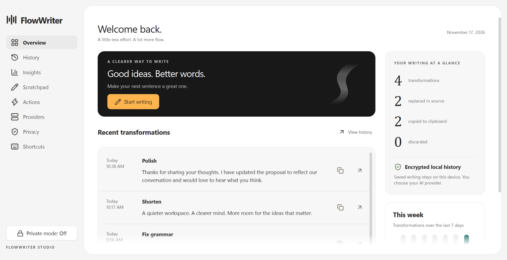
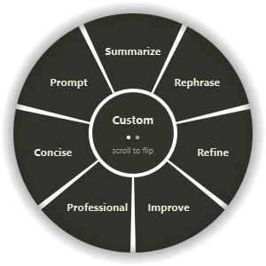
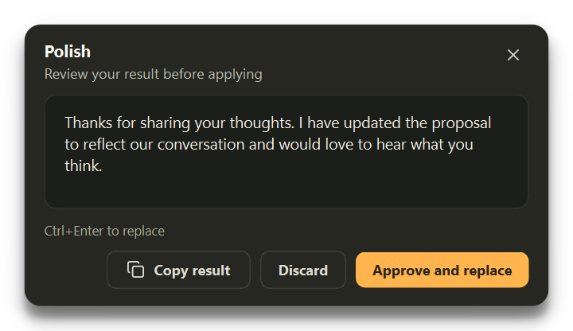

<div align="center">

# FlowWriter Studio

**Select text in any app. Rewrite it with any AI model.**

An open-source, local-first desktop writing assistant. Hold a key and drag-select text anywhere, pick an action from a radial wheel, review the result, and apply it. It works with any OpenAI-compatible model, including local ones like Ollama.



</div>

> Inspired by voice tools like [Wispr Flow](https://wisprflow.ai), but for text you have already written. It is an independent project and is not affiliated with Wispr Flow.

> **Status: v0.9, preview.** Developed and tested on Windows only. macOS and Linux are untested, so treat them as experimental. Several features are Windows-only for now: direct "replace" (other systems copy the result instead), skipping terminals and file managers, and the shortcut-clash warning. The Windows build is unsigned. See [platform support](docs/PLATFORMS.md).

## Features

- **Radial action wheel** on any selected text. Two faces of up to 8 actions each, with a custom prompt in the centre.
- **Prompt action** that turns a rough idea into a structured prompt (Role, Task, Context, Requirements, Output format) without answering it.
- **Any model.** Works with any OpenAI-compatible `/chat/completions` endpoint: Ollama, LM Studio, vLLM or a hosted API. The model name is never hard-coded. Streaming and reasoning models are supported.
- **Review before you apply.** Edit the result, then replace, copy or discard. Nothing changes until you approve.
- **Private by default.** History is encrypted on your device, API keys live in the OS keychain, and there is no telemetry. A private mode stops new history from being saved.
- **Your own shortcuts.** Choose the hold-and-drag keys or a global key. On Windows, the app tells you if another app already uses the key.
- **Dashboard** with history search, a scratchpad, an action editor, and insights that group your writing by app.

<p align="center">
  
  &nbsp;&nbsp;
  
</p>

## Quick start

You need Python 3.11 or newer.

**Windows:** run `Start-FlowWriter.cmd`. It creates a virtual environment, installs the dependencies and starts the app.

**macOS / Linux:**

```bash
chmod +x start-flowwriter.sh
./start-flowwriter.sh
```

**Any system, manually:**

```bash
python -m venv .venv
# Windows: .venv\Scripts\Activate.ps1      macOS/Linux: source .venv/bin/activate
python -m pip install -e .
python -m flowwriter
```

On macOS, allow Accessibility access for the app or terminal you launch it from. On Linux, global selection needs X11. To build a standalone Windows `.exe`, run `Build-Desktop-App.cmd` (see the [advanced guide](docs/ADVANCED.md#create-a-per-os-executable-bundle)).

## Connect a model

1. Open **Providers**.
2. Use the default `Local Ollama` profile, or click **Add provider**.
3. Enter the base URL (usually ending in `/v1`), a model ID and an optional API key.
4. Click **Test connection**, then **Save and activate**.

| Service | Base URL | Model ID |
|---|---|---|
| Ollama | `http://localhost:11434/v1` | any model you have pulled |
| LM Studio | `http://localhost:1234/v1` | the loaded model |
| vLLM | `http://localhost:8000/v1` | the served model |
| Hosted API | `https://provider.example.com/v1` | your chosen model |

API keys are only sent over HTTPS or to localhost. No account or API key is needed to try the app: run `python scripts/mock_provider.py` for a free test server ([details](docs/ADVANCED.md#test-with-zero-api-cost)).

## How to use it

1. Select text in any app while holding **Ctrl** (**Cmd** on a Mac), or select it and press **Ctrl + Alt + Space**.
2. Pick an action on the wheel. Scroll to flip to the other face. Click the centre to type your own instruction.
3. Review the result, edit it if you like, then **Approve and replace**, **Copy result** or **Discard**.

Change the keys on the **Shortcuts** page. On Windows, terminals, file managers and password-manager windows are skipped by default.

## Privacy and security

- Saved text is encrypted with a key kept in your OS keychain. If the keychain is unavailable, history is paused rather than stored in plain text.
- Text is sent only to the model endpoint you configure, and only when you run an action.
- Global key and mouse hooks read only which modifier keys are held, the configured shortcut and drag distance. Typed text is never read.
- Encryption protects the file at rest. It does not replace full-disk encryption. Do not use the app on secrets or protected records.

Read the full model and its limits in [docs/SECURITY.md](docs/SECURITY.md).

## Development

```bash
python -m pip install -e ".[test]"
python -m pytest -q
```

Render the screens from synthetic data (no hooks, no API calls):

```bash
python scripts/preview_ui.py --page 0 --output overview.png
python scripts/preview_overlays.py --output-dir out
```

| Document | Contents |
|---|---|
| [docs/ARCHITECTURE.md](docs/ARCHITECTURE.md) | How the pieces fit together |
| [docs/ADVANCED.md](docs/ADVANCED.md) | Data location, keys, test server, packaging |
| [docs/TESTING.md](docs/TESTING.md) | What is tested and what needs manual checks |
| [docs/PLATFORMS.md](docs/PLATFORMS.md) | What works on each operating system |
| [CONTRIBUTING.md](CONTRIBUTING.md) | How to contribute |

## License

[MIT](LICENSE). Icons are from [Lucide](https://lucide.dev) (ISC). See [THIRD_PARTY_NOTICES.md](THIRD_PARTY_NOTICES.md) for all third-party licences.

The radial action menu is inspired by the one in Filee. The project is independent of both Filee and Wispr Flow.
